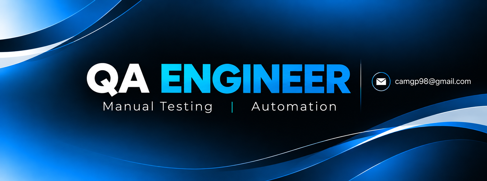

  

#  ¡Hola! Soy Camilo Andrés González Pineda 

###  QA Tester Junior | Manual Testing | API Testing | Test Automation

Soy Técnico Laboral en Desarrollo de Software y actualmente me estoy formando como QA Engineer en TripleTen. Estoy construyendo mi portafolio mediante proyectos prácticos de testing manual, pruebas de API y automatización de pruebas end-to-end (E2E).

A través de estos proyectos he diseñado y ejecutado casos de prueba, validado escenarios positivos y negativos, comparado resultados esperados con los obtenidos y documentado defectos con sus pasos de reproducción y evidencias.

Me caracterizo por la atención al detalle, el pensamiento analítico, la resolución de problemas y el aprendizaje continuo. Mi objetivo es contribuir a la calidad del software mientras continúo desarrollándome profesionalmente en QA.

  

##  Habilidades técnicas

**Testing:** Manual Testing · Functional Testing · UI Testing · End-to-End Testing (E2E) · Smoke Testing · Regression Testing · Test Case Design · Bug Reporting

**API Testing:** Postman · Swagger · REST APIs · HTTP · JSON

**Automatización:** Cypress · JavaScript · Assertions · Selectors

**Herramientas:** Jira · Git · GitHub · VS Code · Chrome DevTools

**Bases de datos:** SQL básico · MySQL

**Tecnologías web:** HTML5 · CSS3

**Metodologías y procesos:** Agile · Scrum · SDLC · STLC

## 📚 Aprendizaje continuo

Actualmente continúo fortaleciendo mis conocimientos en SQL aplicado a QA, buenas prácticas de automatización y técnicas de prueba de software.

##  Objetivo profesional

Busco una oportunidad como **QA Tester Junior** en la que pueda aplicar mis conocimientos de testing manual, API Testing y automatización, colaborar con un equipo de tecnología y seguir creciendo profesionalmente en Quality Assurance.

## 📫 Contacto

- **Correo:** camgp98@gmail.com

Estoy abierto a conectar con profesionales y equipos del área de QA y tecnología.

